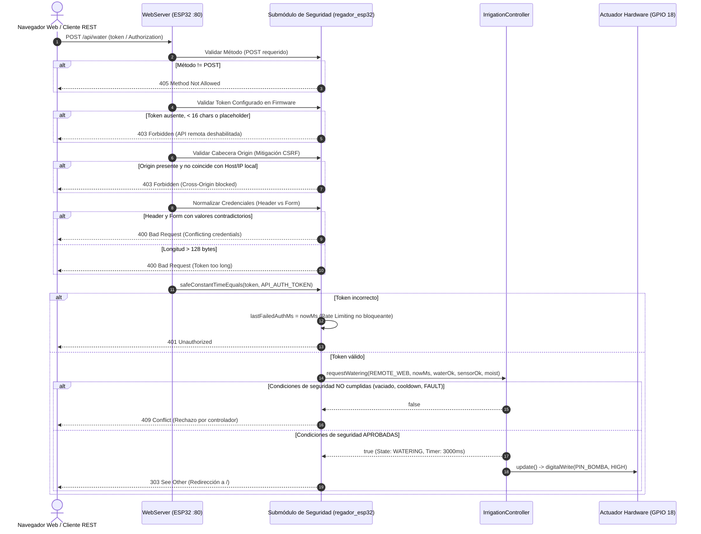

# 🧠 Contexto del Proyecto y Memoria Activa de Ingeniería (Living Context)

> **Documento Vivo de Estado, Arquitectura, Seguridad y Trazabilidad para Onboarding de IA.**
> Este documento permite a cualquier agente de IA o ingeniero sénior retomar de inmediato el proyecto **Smart FloraCare** sin depender de historiales de conversación, eliminando ambigüedades entre el software probado, la seguridad de red y el hardware físico en desarrollo.

---

## 📌 1. Objetivo y Misión del Producto
- **Nombre del Proyecto:** Smart FloraCare (Regador Automático Inteligente de Maceta Única).
- **Misión de Ingeniería:** Proveer un sistema de autorriego por goteo determinista, silencioso, seguro contra inundaciones por cavitación o efecto sifón, con arquitectura desacoplada de estándar internacional, optimizado ergonómicamente para personas mayores (caso de uso de validación: abuela del creador).
- **Alcance Operativo Estricto:** Automatización de una **única maceta de interior** desde un **depósito de agua dedicado** (1.5 L a 3.0 L).
- **Origen:** Ingeniería inversa del circuito de Wirecora (YouTube Short `KClvikj9jAk`), sustituyendo transistores Darlington con pérdidas y sensores resistivos galvánicos por control de nivel lógico, sensores capacitivos, interlocks de seguridad y arquitectura en capas.

---

## 🏛️ 2. Arquitectura General y Capas del Sistema
El firmware adopta una **Arquitectura en Capas Desacoplada (Layered Architecture)**:

```text
+-------------------------------------------------------------------------------------------------+
| 5. CAPA DE PRESENTACIÓN / TELEMETRÍA (UI & Feedback)                                            |
|    - DisplayView: Interfaz OLED SSD1306 (128x64 I2C), tipografía grande y métricas claras       |
|    - AcousticAlert: Avisos discretos atenuados (850 Hz, 100 ms) vía zumbador piezoeléctrico     |
|    - WebDashboard (Solo ESP32): Servidor HTTP local con visualización de estado y formulario     |
+-------------------------------------------------------------------------------------------------+
                                                ▲
                                                │ Eventos / Mapeos
+-------------------------------------------------------------------------------------------------+
| 4. CAPA DE APLICACIÓN Y CONTROL DE DOMINIO                                                      |
|    - IrrigationController.h: FSM libre de heap gobernada por deltas de millis()                |
|    - Temporizadores de Seguridad: Límite automático de 20s y Perro Guardián absoluto de 25s     |
|    - Anti-inundación: Interbloqueo estricto por nivel de boya y período de reposo (Cooldown 5s)|
+-------------------------------------------------------------------------------------------------+
                                                ▲
                                                │ Muestras filtradas / Salud de sensor
+-------------------------------------------------------------------------------------------------+
| 3. CAPA DE PROCESAMIENTO DE SEÑALES Y SERVICIOS                                                 |
|    - SensorValidator.h: Validación analógica, plausibilidad física y cálculo inverso de humedad |
|    - SignalFilter: Sobremuestreo 16x y promedio móvil para inmunidad a ruido de conmutación     |
|    - DebounceFilter: Antirrebote no bloqueante para flotador (50 ms) y botón manual (40 ms)     |
+-------------------------------------------------------------------------------------------------+
                                                ▲
                                                │ Lecturas ADC / Control digital
+-------------------------------------------------------------------------------------------------+
| 2. CAPA DE CONTROLADORES DE DISPOSITIVOS (Drivers)                                              |
|    - PumpDriver: Accionamiento de potencia activo en HIGH con corte forzado en arranque/reset   |
|    - CapacitiveSensorDriver: Interfaz para sensor v1.2 sin corrosión                            |
|    - FloatSwitchDriver: Interfaz para contacto seco magnético en modo INPUT_PULLUP              |
+-------------------------------------------------------------------------------------------------+
                                                ▲
                                                │ HAL / Registro de pines
+-------------------------------------------------------------------------------------------------+
| 1. CAPA DE ABSTRACCIÓN DE HARDWARE (HAL / Board Target)                                         |
|    - Arduino AVR (ATmega328P, 5.0V nativo, 16 MHz, 2KB RAM, 30KB Flash)                         |
|    - Espressif ESP32 (Xtensa Dual-Core 32-bit, 3.3V nativo, 240 MHz, Wi-Fi 802.11 b/g/n)        |
+-------------------------------------------------------------------------------------------------+
```

---

## 🔌 3. Variantes de Hardware y Reglas de Convivencia Dual
El proyecto soporta dos variantes de microcontrolador desarrolladas en paralelo:

1. **Variante A: Arduino Nano V3 (5.0V Nativo)**
   - Microcontrolador: ATmega328P.
   - Sensor de suelo capacitivo v1.2 alimentado a **5.0V** (salida $0.0\,\text{V}-5.0\,\text{V}$ conectada a `A0`).
   - Driver de bomba: MOSFET **IRLZ44N** accionado directamente desde pin `D3` con $R_{\text{gate}} = 1\,\text{k}\Omega$ y $R_{pd} = 10\,\text{k}\Omega$.
   - Perfil agronómico precargado: Estándar (Arranque $\le 20\%$, Parada $\ge 70\%$).
   - Modo de operación: Autónomo estricto (pantalla OLED + buzzer pasivo + botón manual).
2. **Variante B: ESP32 DevKit V1 (3.3V Nativo)**
   - Microcontrolador: ESP-WROOM-32 (30 pines).
   - Sensor de suelo capacitivo v1.2 alimentado obligatoriamente a **3.3V** (salida $\le 3.0\,\text{V}$ conectada a `GPIO 34` / ADC1_CH6 para evitar sobretensión destructiva en el pin).
   - Driver de bomba: **Driver No Inversor Bipolar de 2 Etapas (Q1 NPN 2N2222A + Q2 PNP 2N3906)** excitando la compuerta del IRLZ44N a $+4.85\,\text{V}$ teóricos desde `GPIO 18`.
   - Perfil agronómico precargado: Tropical (Arranque $\le 25\%$, Parada $\ge 70\%$).
   - Modo de operación: Autónomo IoT (Web Dashboard local + API REST protegida por Bearer token / Formulario).
3. **Reglas Críticas de Convivencia Dual en Banco:**
   - **Aislamiento Eléctrico Absoluto:** Ambas placas jamás se interconectan eléctricamente ni comparten buses de señal. La protoboard ensaya una sola variante a la vez.
   - **Masa Común:** Riel de tierra (`GND`) sólidamente unificado entre la fuente externa de 5V (2A–3A), el microcontrolador activo y los terminales de potencia de los drivers.

---

## 🛡️ 4. Seguridad de Firmware y Arquitectura de Autenticación IoT (ESP32)

### Flujo de Autenticación y Control Remoto


### Medidas de Endurecimiento Implementadas
1. **Comparación en Tiempo Constante (`safeConstantTimeEquals`):** Evaluación bit a bit en bucle volátil para eliminar oráculos de tiempo en la validación del token.
2. **Defensa contra CSRF en Navegadores:** Inspección canónica estricta de las cabeceras `Origin` y `Referer` contrastadas de forma exclusiva contra `WiFi.localIP()` (rechazando esquemas cruzados, puertos truncados o dispares, corchetes IPv6 y userinfo incrustado). Clientes sin navegador (cURL/scripts) no envían `Origin` ni `Referer` y son autenticados mediante Bearer token.
3. **Límite de Longitud contra DoS de Memoria:** `MAX_TOKEN_LEN = 128` bytes; previene saturación de heap en peticiones malformadas.
4. **Normalización Dual de Credenciales:** Admite `Authorization: Bearer <token>` y `token=<token>` (formulario), pero rechaza valores dispares con `400 Bad Request`.
5. **Bloqueo de Placeholders de Plantilla:** Inhabilita la API (`403 Forbidden`) si el token configurado es un marcador por defecto (`GENERA_UN_TOKEN...`, `CAMBIA_ESTE...`).
6. **Limitación de Tasa No Bloqueante (Rate Limiting):** Marca temporal `lastFailedAuthMs` que responde con `429 Too Many Requests` en $< 0.1\,\text{ms}$ ante reintentos sucesivos dentro de 1000 ms, sin bloquear la CPU ni degradar la frecuencia del bucle `loop()` ni el debouncing del flotador.
7. **Restricción de Transporte HTTP:** Operación estrictamente acotada a red local privada (VLAN IoT); prohibición categórica de port-forwarding hacia Internet.

---

## 📊 5. Estado Actual de Compilación y Memoria
- **Arduino Nano V3 (`env:nanoatmega328`):**
  - Compilación PlatformIO: `SUCCESS` en 2.59 s.
  - Memoria Flash (Programa): `17,554 bytes` utilizados de `30,720 bytes` (**57.1%**).
  - Memoria SRAM (Dinámica): `614 bytes` utilizados de `2,048 bytes` (**30.0%**).
- **ESP32 DevKit V1 (`env:esp32dev`):**
  - Compilación PlatformIO: `SUCCESS` en 23.29 s.
  - Memoria Flash (Programa): `1,081,895 bytes` utilizados de `1,310,720 bytes` (**82.5%**).
  - Memoria SRAM (Dinámica): `49,412 bytes` utilizados de `327,680 bytes` (**15.1%**).
  - Secretos: Cero credenciales hardcodeadas; gestión en `Credentials.h` ignorado por Git.

---

## 🧪 6. Jerarquía de Pruebas y Validación (Niveles A, B1, B2, B3 y C)
El proyecto establece una taxonomía formal de verificación en 5 niveles, distinguiendo con total rigor técnico entre comprobaciones estáticas, modelos simulados, compilación binaria y ensayos en hardware real:

```
+-----------------------------------------------------------------------------------------+
|                        TAXONOMÍA FORMAL DE PRUEBAS SMART FLORACARE                      |
+-----------------------------------------------------------------------------------------+
| Nivel A: Análisis Estático y Linters de Código Fuente [APROBADO]                        |
|   - tests/test_firmware_security.py (12 pruebas superadas en 0.002s).                   |
|   - Cero credenciales hardcodeadas, recolección de cabeceras, macros y límites.         |
+-----------------------------------------------------------------------------------------+
| Nivel B1: Simulación de Lógica de Dominio y Máquina de Estados en Python [APROBADO]      |
|   - tests/test_irrigation_suite.py (30 pruebas superadas en 0.005s).                    |
|   - Modelo MockHttpServerEndpoint en tests/test_http_auth_security.py (33 pruebas).     |
|   - Cobertura: FSM, interlocks, WDT 25s, desbordamiento millis, matriz 4xx/5xx HTTP.    |
+-----------------------------------------------------------------------------------------+
| Nivel B2: Compilación y Verificación de Binarios ELF [APROBADO PARA COMPILACIÓN]        |
|   - PlatformIO Core 6.2.0 (AVR-GCC 7.3.0 y Xtensa-GCC 14.2.0): 0 errores, 0 warnings.  |
|   - Desensamblado de safeConstantTimeEquals() mediante xtensa-esp32-elf-objdump:        |
|     confirmación empírica de operaciones xor/or branchless y cond-move moveqz.          |
+-----------------------------------------------------------------------------------------+
| Nivel B3: Integración HTTP sobre Firmware Real Compilado [PENDIENTE DE EVIDENCIA]       |
|   - Evaluación del servidor HTTP nativo (WebServer) ante peticiones lentas (Slowloris), |
|     inundación de conexiones concurrentes y fragmentación de Heap en hardware/emulador. |
+-----------------------------------------------------------------------------------------+
| Nivel C: Validación Física Instrumental en Banco de Pruebas [PENDIENTE DE HARDWARE]     |
|   - Protocolo ACT-01 a ACT-06: osciloscopio en Gate MOSFET, corriente de pico,         |
|     sensor capacitivo en sustrato real, flotador con agua y válvula anti-sifón.         |
|   - OPERACIÓN DESATENDIDA ESTRICTAMENTE PROHIBIDA hasta superar este nivel.             |
+-----------------------------------------------------------------------------------------+
```

### Resumen de Pruebas Automatizadas de Software (Niveles A y B1):
```bash
# Ejecutar la suite completa de 75 pruebas de software:
python -m unittest discover -v -s tests
# Resultado: Ran 75 tests in 0.011s -> OK (100% éxito)
```

---

## 📋 7. Matriz de Seguimiento del Sistema (Taxonomía Ontológica de 6 Estados)

Estados permitidos: `DOCUMENTADO`, `CALCULADO`, `VERIFICADO POR SOFTWARE`, `MEDIDO EN HARDWARE`, `PENDIENTE DE VALIDACIÓN`, `NO AUTORIZADO`.

| Componente / Subsistema | Estado Ontológico | Evidencia Verificable | Limitación / Prerrequisito Pendiente |
| :--- | :---: | :--- | :--- |
| **Arquitectura de Software en Capas** | `VERIFICADO POR SOFTWARE` | Compilación PlatformIO en Nano y ESP32; separación estricta en headers. | Ninguna en software. |
| **Controlador Centralizado de Riego** | `VERIFICADO POR SOFTWARE` | `tests/test_irrigation_suite.py` (30 pruebas superadas). | Ninguna en software. |
| **Interlocks de Seguridad (Boya y Watchdog)** | `VERIFICADO POR SOFTWARE` | Límite inmutable de 20s/25s y enclavamiento de flotador verificados en tests. | Ensayo instrumental ACT-04 en banco físico. |
| **Autenticación HTTP y Manejo de Tokens** | `VERIFICADO POR SOFTWARE` | `tests/test_http_auth_security.py` (33 pruebas superadas). | Validación sobre hardware ESP32 real en banco. |
| **Comparación de Token en Tiempo Constante** | `VERIFICADO POR SOFTWARE` | `safeConstantTimeEquals()` implementada y validada en test estático y de lógica. | Análisis oscilográfico de jitter de red LAN. |
| **Defensa contra CSRF (Origin Checking)** | `VERIFICADO POR SOFTWARE` | `isOriginAllowed()` implementada y probada con orígenes legítimos y maliciosos. | Comprobación en navegador web real conectado al ESP32. |
| **Límite de Longitud de Entrada (128 B)** | `VERIFICADO POR SOFTWARE` | Rechazo con 400 Bad Request validado en `test_http_auth_security.py`. | Ninguna. |
| **Aislamiento de Transporte HTTP en LAN** | `DOCUMENTADO` | Restricción de despliegue a VLAN IoT documentada en README y FMEA. | Configuración de red externa y proxy inverso TLS. |
| **Manejo Seguro de Credenciales (Credentials.h)** | `VERIFICADO POR SOFTWARE` | `.gitignore` activo, plantillas limpias y fallback seguro verificado en tests. | Creación local por parte del usuario final. |
| **Resiliencia ante Caída de Wi-Fi** | `VERIFICADO POR SOFTWARE` | Test 29: el lazo de control local continúa ejecutándose sin cuelgues. | Reconexión periódica en caliente (Fase 4). |
| **Driver de Potencia MOSFET (Nano 5V)** | `CALCULADO` | $V_{GS}=5.0\,\text{V}$, $R_{DS(on)} \le 0.035\,\Omega$, $V_{DS} \approx 12.3\,\text{mV}$ a $350\,\text{mA}$. | Medición física con multímetro True RMS (ACT-05). |
| **Driver Bipolar NPN+PNP (ESP32 3.3V)** | `CALCULADO` | Análisis nodal: $V_{GS} \approx 4.85\,\text{V}$, $I_{B1}=2.6\,\text{mA}$, $I_{B2}=1.84\,\text{mA}$. | Medición física de tensión Gate en banco (ACT-05). |
| **Diodo Flyback 1N5819 (Schottky)** | `CALCULADO` | $V_{RRM}=40\,\text{V}$, $I_F=1.0\,\text{A}$, supresión instantánea $t_{rr} \approx 0$. | Inspección con osciloscopio digital (ACT-05). |
| **Modelo Térmico TO-220 ($R_{\theta JA}=62^\circ\text{C/W}$)** | `CALCULADO` | $\Delta T_{estacionario} \approx 0.27^\circ\text{C}$ a $350\,\text{mA}$; pulso de 20s no alcanza equilibrio. | Medición con termómetro IR o termocupla (ACT-05). |
| **Corriente de Bloqueo del Motor (Stall 1.2A)** | `CALCULADO` | $P_{cond} \approx 50.4\,\text{mW}$; prohibición de trabar manualmente el rotor. | No inducir bloqueo intencional en banco. |
| **Sensor Capacitivo v1.2 (Plausibilidad)** | `VERIFICADO POR SOFTWARE` | `SensorValidator.h` detecta desconexión y cortocircuito a GND. | Caracterización de suelo y calibración ACT-01/ACT-02. |
| **Prevención Hidráulica Anti-Sifón** | `DOCUMENTADO` | Reglas de Air Gap $\ge 2\,\text{cm}$ y orificio de venteo de $1.5\,\text{mm}$. | Prueba física de descarga ACT-06. |
| **Placa Comercial HW-517 (MOSFET Dual)** | `PENDIENTE DE VALIDACIÓN` | BOM lista HW-517 como alternativa sujeta a comprobación de $V_{GS}$. | Verificar lote y saturación a 3.3V antes de energizar. |
| **Módulos de Relé Electromecánico** | `NO AUTORIZADO` | Descartado en arquitectura y ADR-001 por arco inductivo y ruido EMI. | Prohibido en diseño definitivo. |
| **MOSFET Estándar FQP30N06L** | `NO AUTORIZADO` | Descartado por requerir $V_{GS}=10\,\text{V}$ para saturación completa. | Prohibido en diseño de 5V y 3.3V. |
| **Operación Desatendida del Sistema** | `NO AUTORIZADO` | Bloqueada formalmente hasta aprobar ensayos físicos ACT-01 a ACT-06. | Requiere supervisión visual humana constante. |
| **Reenvío de Puertos WAN (Port Forwarding)** | `NO AUTORIZADO` | Bloqueado por análisis de riesgo FMEA (transporte HTTP sin cifrar). | Prohibido exponer puerto 80 a Internet público. |

---

## 📌 8. Prerrequisitos para Declarar el Cierre de Hardware
1. **ACT-01 / ACT-02:** Calibración de sensor capacitivo en aire, agua y muestra real de suelo.
2. **ACT-04:** Verificación instrumental de tensión de compuerta ($V_{GS} = 0.0\,\text{V}$) durante arranque y reset.
3. **ACT-05:** Ensayo térmico de 20s con motor sumergido: comprobación de $V_{DS} \le 50\,\text{mV}$, $T_{case} \le 45^\circ\text{C}$ y $\Delta T \le 15^\circ\text{C}$, y ausencia de transitorios inductivos con osciloscopio.
4. **ACT-06:** Comprobación práctica de rotura de sifón con reservorio elevado.
5. **Supervisión Asistida:** Registro de 72 horas de operación continua bajo supervisión técnica antes de conectar a vegetación viva.
