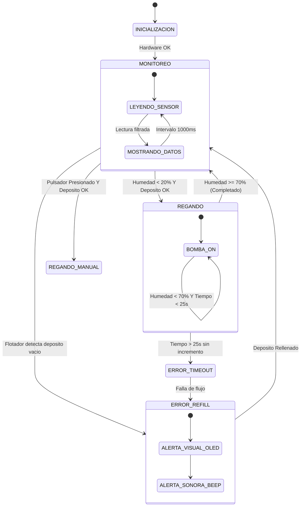

# 📐 01. Arquitectura y Especificación del Sistema (Estándar Internacional)

Este documento describe la arquitectura formal, el modelo en capas, la máquina de estados finita (FSM) y los mecanismos de seguridad y tolerancia a fallos del sistema de autorriego **Smart FloraCare**.

---

## 1. Arquitectura de Software en Capas (Layered Architecture)

Siguiendo las mejores prácticas internacionales para software embebido de misión crítica (IEC 61508 / MISRA C++), el sistema se organiza en capas desacopladas con dependencias estrictamente unidireccionales (de arriba hacia abajo):

```text
+--------------------------------------------------------------------------+
| CAPA 5: PRESENTACIÓN Y HMI (Human-Machine Interface)                     |
|  - DisplayView: Renderizado gráfico en OLED SSD1306 con telemetría clara |
|  - AcousticAlert: Avisos auditivos de baja frecuencia con buzzer pasivo  |
+--------------------------------------------------------------------------+
                                    ▲
                                    │ eventos / datos filtrados
+--------------------------------------------------------------------------+
| CAPA 4: DOMINIO Y APLICACIÓN                                             |
|  - Finite State Machine (FSM): MONITORING, WATERING_AUTO, MANUAL, ALERT  |
|  - Safety Interlocks: Watchdog anti-inundación y corte por vaciado       |
+--------------------------------------------------------------------------+
                                    ▲
                                    │ señales procesadas
+--------------------------------------------------------------------------+
| CAPA 3: SERVICIOS Y FILTRADO DE SEÑAL                                    |
|  - SignalFilter: Sobremuestreo analógico (16x) y promediado móvil        |
|  - CalibrationMapper: Conversión inversa no lineal ADC -> Humedad %      |
+--------------------------------------------------------------------------+
                                    ▲
                                    │ lecturas / comandos de driver
+--------------------------------------------------------------------------+
| CAPA 2: CONTROLADORES DE DISPOSITIVO (DRIVERS)                           |
|  - PumpDriver: Control de potencia MOSFET (IRLZ44N / FQP30N06L)          |
|  - CapacitiveSensorDriver: Interfaz analógica libre de corrosión         |
|  - FloatSwitchDriver: Interfaz de contacto seco magnético                |
+--------------------------------------------------------------------------+
                                    ▲
                                    │ registros / pines
+--------------------------------------------------------------------------+
| CAPA 1: ABSTRACCIÓN DE HARDWARE (HAL / TARGET)                           |
|  - Arduino AVR (ATmega328P @ 16 MHz) / Espressif ESP32 (Xtensa Dual-Core)|
+--------------------------------------------------------------------------+
```

---

## 2. Puntos Críticos y Mejoras de Ingeniería

### 2.1 Limitaciones del Diseño Original
1. **Caída de tensión del TIP120:** El TIP120 es un transistor BJT Darlington. Presenta un $V_{CE(sat)}$ típico de 0.8V a 1.2V. En un circuito de 5V, la bomba recibe únicamente ~3.8V a 4.2V, reduciendo notablemente el caudal y disipando energía en forma de calor en el transistor.
2. **Ausencia de alerta acústica:** Una pantalla OLED de 0.96" tiene letras de 2 a 3 mm de alto. Para un adulto mayor (tu abuela), notar el aviso "REFILL" requiere acercarse e inspeccionar de cerca la planta.
3. **Desgaste por cebado en vacío:** Si el depósito se vacía, la bomba funcionará en seco durante 30 segundos cada ciclo hasta que alguien la apague, lo que desgasta prematuramente las microbombas sumergibles sin escobillas.

### 2.2 Arquitectura Mejorada (Mismo Presupuesto)
1. **Reemplazo del Driver por MOSFET N-Channel (IRLZ44N o Módulo MOSFET/Relé de 5V):**
   - Resistencia en conducción $R_{DS(on)} < 0.03\,\Omega$.
   - Caída de tensión despreciable (< 0.05V): la bomba recibe el 100% de la fuerza de bombeo y el componente permanece completamente frío.
2. **Sensor de Nivel de Depósito (Flotador de Nivel):**
   - Un interruptor magnético de flotador tipo boya de $0.80 USD.
   - Si no hay agua en el depósito, la bomba **jamás se enciende**, evitando el cebado en vacío.
3. **Buzzer Activo (Aviso Sonoro Amigable):**
   - Genera un pitido suave intermitente cuando falta agua, alertando de forma intuitiva.
4. **Pulsador de Riego Manual (Override):**
   - Permite dar un pulso de riego controlado (ej. 3 segundos) si se desea regar manualmente sin alterar la automatización.

---

## 3. Máquina de Estados Finita (FSM)

El firmware se rige por la siguiente máquina de estados no bloqueante (usando `millis()` en lugar de `delay()` para garantizar respuesta en tiempo real):



---

## 4. Estrategia de Filtrado de Señal

Los sensores capacitivos pueden presentar ruido analógico generado por el acoplamiento electromagnético del motor de la bomba o fluctuaciones de la fuente:
- **Sobremuestreo (Oversampling):** Se toman 16 muestras consecutivas separadas por 5 ms y se calcula el promedio.
- **Histéresis:** 
  - Activación: $\le 20\%$ de humedad.
  - Desactivación: $\ge 70\%$ de humedad.
  - Esta banda muerta de 50% previene el ciclado rápido (oscilación on/off rápida).
- **Protección de Inundación (Watchdog de Bombeo):** Tiempo máximo absoluto de bombeo continuo de 25 segundos. Si se alcanza este límite, la bomba se corta forzosamente aunque el sensor no haya reportado 70%.
